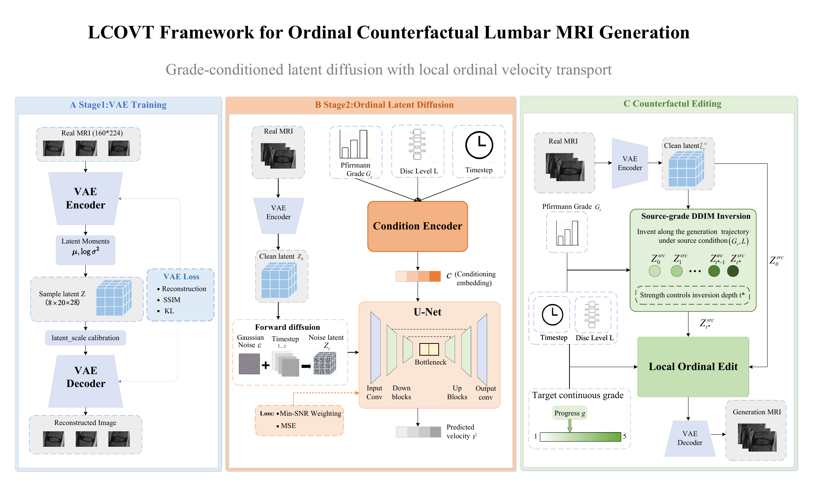
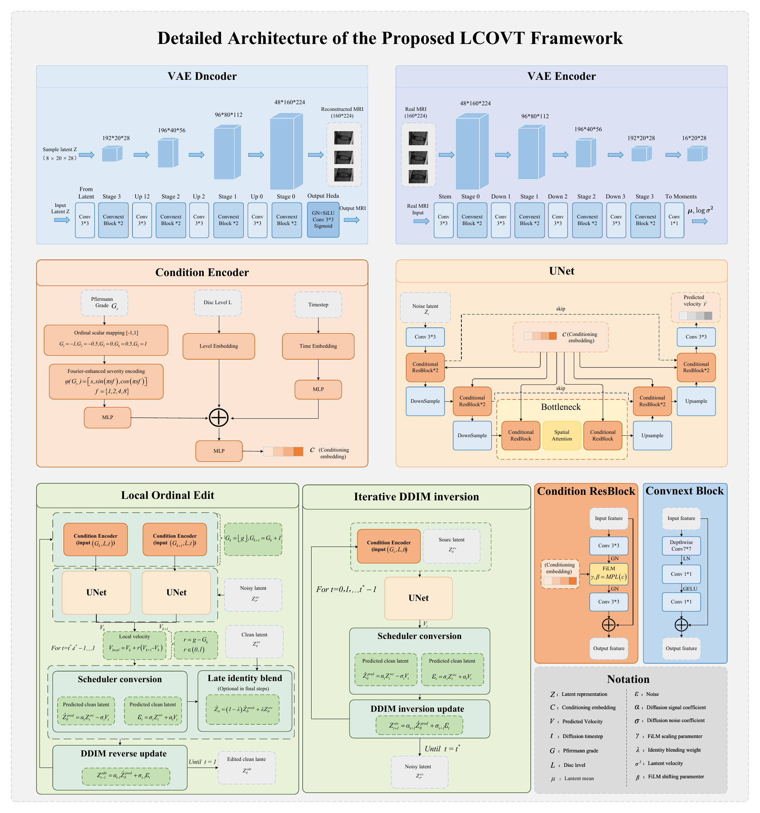
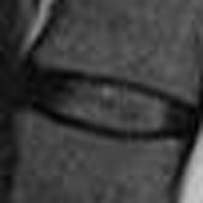
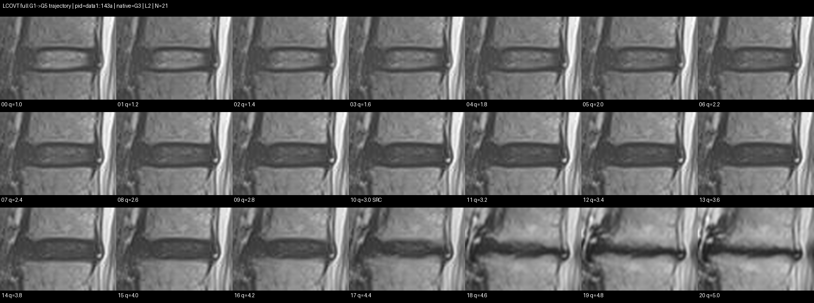

# SPIDER：腰椎 MRI 有序条件生成与连续退变表征

**从单张椎间盘 MRI 出发，构建等级可控生成、连续退变轨迹与单图严重程度评分的研究流程。**

SPIDER 围绕 Pfirrmann G1–G5 的有序结构，连接影像预处理、ConvNeXt 风格 VAE、有序条件潜空间扩散、LCOVT 连续轨迹生成、多模型评价与等级盲 DDS 评分。项目研究的不仅是等级识别，还包括如何控制影像表征沿退变方向连续变化，并把生成轨迹中的相对顺序用于训练单图评分模型。

本仓库来自完整 SPIDER 项目的核心代码整理，覆盖模型、训练、生成与评估；仓库名称沿用 SPIDER-Grade-Blind-DDS。

## 项目亮点

- **有序条件表达**：将 G1–G5 映射到连续严重度坐标，结合 Fourier 特征与节段条件，显式利用等级顺序。
- **潜空间生成建模**：先学习 MRI 压缩表征，再训练条件扩散模型，分别处理图像重建与等级分布学习。
- **推理阶段连续控制**：LCOVT 利用相邻等级扩散速度差构建控制方向，生成覆盖 G1→G5 的 21 帧连续轨迹。
- **生成轨迹驱动评分**：用轨迹中的相对排序训练 Residual MLP++，推理时仅输入单张 MRI 的潜变量特征。
- **可审查的模型发布**：记录检查点配置、VAE 哈希匹配关系和实验口径，区分重建、扩散训练与轨迹评价结果。

## 模型结构与结果展示

### 总体模型框架



从 VAE 重建训练、有序条件潜空间扩散，到基于源图像的 DDIM inversion 与 Local Ordinal Edit，形成完整的等级可控 MRI 生成流程。[下载原始矢量 PDF](docs/assets/model_framework.pdf)。

<details>
<summary><strong>展开详细网络结构与速度场控制图</strong></summary>



图中展示 VAE 编解码器、等级/节段/时间条件编码、条件残差块、UNet、DDIM inversion 和局部有序编辑。[下载原始矢量 PDF](docs/assets/detailed_architecture.pdf)。

</details>

模型图以 **160×224 输入、8×20×28 潜变量**为例；具体通道数与计算实现以源码为准。已发布的 224×224 扩散权重及配套 VAE 见下文版本匹配表。

### 连续变化动态示例



用户提供的连续变化可视化示例，用于直观展示椎间盘区域外观的过渡效果。该动图作为展示素材，不单独作为生成质量或定量性能的证据。

### G1→G5 的 21 帧 LCOVT 轨迹



目标等级 q 从 1.0 递增至 5.0，步长 0.2；图中 q=3.0 标记为源影像位置（SRC）。该示例展示连续控制下的外观变化，不代表真实患者的纵向病程，也不用于推断已发布 224×224 权重的定量表现。[查看原尺寸轨迹图](docs/assets/lcovt_g1_g5_trajectory.png)。

## 总体流程


## 方法与技术设计

### 1. 影像预处理与稳定潜空间

预处理脚本提取椎间盘二维区域，为模型准备灰度图像。VAE 使用 ConvNeXt 风格卷积块和三级下采样/上采样，潜变量为 8 通道。160×224 输入对应 8×20×28 潜变量，224×224 输入对应 8×28×28 潜变量。

VAE 联合优化重建项、SSIM 结构相似度项和 KL 正则，并采用 KL warm-up、EMA 与 latent scale 校准。其作用是保留重建细节，同时为后续扩散模型提供尺度明确的表示空间。

### 2. 有序条件潜空间扩散

等级条件使用 G1→−1、G2→−0.5、G3→0、G4→0.5、G5→1 的映射，通过 Fourier 特征表达严重度，再与时间嵌入、椎间盘节段嵌入共同进入条件网络。

扩散网络预测速度 v，训练使用 Min-SNR 加权、条件 dropout、EMA、梯度裁剪与混合精度；采样支持 DDIM 和 classifier-free guidance。训练采样按等级与节段的组合频次加权，缓解不同条件的样本数量不均衡。

这些设计服务于有序条件表达、训练稳定性与条件覆盖。当前未公开逐项消融，因此不把每项机制单独宣称为已经证实的性能增益。

### 3. LCOVT：相邻等级速度场的连续控制

LCOVT（Local Contrastive Ordinal Velocity Transport）将表示引导与对比控制的思想用于扩散速度场。对于连续等级 q=k+r，使用相邻的两个已训练整数等级：

```text
Δv_k(z_t,t,L) = v(z_t,t,G_(k+1),L) − v(z_t,t,G_k,L)
v_local(q)    = v(z_t,t,G_k,L) + r · Δv_k(z_t,t,L)
```

主方法通过相邻整数等级速度场插值实现连续控制，不需要把未见过的小数等级直接输入条件网络。源 MRI 先经过 VAE 编码和 DDIM inversion，再沿局部等级速度场反向采样并解码为图像。

统一轨迹使用 q=1.0、1.2、…、5.0，共 21 帧，并保留五个整数等级锚点。实现还提供轨迹条件批量推理、CFG 合批计算与输出并行写入等选项，减少逐帧调用和 I/O 开销；目前未发布独立速度基准，因此不报告未经测量的加速倍数。

### 4. 等级盲 DDS：从相对顺序到单图评分

DDS 在训练轨迹上选择 384 维潜变量特征，采用 `384 → 128 → 两个残差块 → 64 → 1` 的 Residual MLP++ 输出连续分数。训练同时利用相邻帧与较大间隔帧的相对顺序。

“等级盲”指评分器推理时只接收单张图像特征，不输入等级标签、轨迹帧号或生成时的 q 值。训练监督仍来自条件生成轨迹的排序，评分有效性需要结合真实影像评价判断。推理需同时加载模型、特征归一化器和校准参数。

## 实验结果

以下数字整理自本地已有记录，本次仓库整理没有重新训练或重新运行评价。只在 README 保留汇总指标，不上传原始实验记录或逐病例结果；上方仅展示用户指定的可视化示例。不同分辨率与检查点的结果分别列出。

### VAE 重建：160×224 版本

来源：`runs_vae_v2_224x160/vae_v2_manifest.json`。训练/验证/测试分别为 8,221 / 1,020 / 1,019 个样本；训练配置为 150 轮、batch size 16、学习率 2×10⁻⁴。

| 测试集指标 | 记录值 |
| --- | ---: |
| SSIM | **0.99763** |
| PSNR | **52.71 dB** |
| L1 | 0.001733 |
| MSE | 0.00000700 |

结果展示了本次预处理与归一化条件下较高的重建保真度。PSNR/SSIM 依赖强度范围、裁剪和实现，不能脱离相同评价口径直接与其他论文比较。

### 扩散训练：224×224 版本

来源：`runs_ordinal_latent_diffusion_v2_newvae/metrics/diffusion.csv` 及 `best.pt` 内部元数据。该运行完成 300 轮，发布的最佳检查点来自第 299 轮。

| 指标 | 第 1 轮 | 最佳检查点（第 299 轮） |
| --- | ---: | ---: |
| 验证 v loss | 0.258001 | **0.078607** |
| 验证 x0 L1 | 0.415914 | **0.243365** |
| 综合验证 score | 0.361980 | **0.139449** |

检查点选择使用 `score = val_v_loss + 0.25 × val_x0_l1`，越低越好。综合分数较首轮约下降 **61.5%**，反映该运行的验证目标得到持续优化；该指标不是分类准确率，也不能直接表示生成图像的临床质量。

主要配置：8 通道潜变量、diffusion base 96、condition dim 384、1,000 个扩散时间步、batch size 16、学习率 8×10⁻⁵、EMA 0.999、Min-SNR gamma 5、条件 dropout 0.12。

### 连续轨迹评价：160×224 版本

来源：`results_generated_eval_6ai_newvae_batch21/trajectory_summary.json` 与对应生成清单。评价覆盖 **1,019 个源样本、21,399 帧、199 个患者 ID**。采用 ResNet50、DenseNet201、ConvNeXt-Tiny、CoAtNet-0、Swin-Tiny、EfficientNet-B3 六种架构，每种三个种子，共 18 个 AI 评价模型。

| 连续轨迹指标 | 记录值 |
| --- | ---: |
| 平均 Spearman（目标等级与 AI 预测严重度的轨迹相关性） | **0.9908** |
| 平均连续等级 MAE | 0.4291 |
| 平均严格相邻递增比例 | **95.06%** |
| 全轨迹严格递增比例 | 45.73% |
| 端点方向为正的轨迹比例 | **100%** |

这些结果支持生成轨迹具有较强的有序变化趋势。全轨迹严格递增比例为 45.73%，说明仍存在局部波动；端点方向一致不能替代逐帧单调性。上述指标来自 AI 评价，不能等同于医生盲评。

作为评价器背景，同一套 AI 共识系统在真实测试影像上的记录为 Accuracy 84.59%、Macro-F1 0.8505、QWK 0.9362。这些是评价系统的识别结果，不是生成模型的准确率。

**版本边界：这组轨迹结果的生成清单引用 `runs_ordinal_ldm_v2_224x160_newvae/checkpoints/best.pt`，与本次补充的 224×224 扩散检查点不同。当前附件不能被宣称为直接复现该组轨迹数值的完整模型组合。**

## 模型下载与版本匹配

附件位于 [v1.0.0 Release](https://github.com/ali030202/SPIDER-Grade-Blind-DDS/releases/tag/v1.0.0)。下载后放入本地 `weights/`。

| 模型文件 | 用途与配套关系 |
| --- | --- |
| [ordinal_latent_diffusion_v2_224x224_best.pt](https://github.com/ali030202/SPIDER-Grade-Blind-DDS/releases/download/v1.0.0/ordinal_latent_diffusion_v2_224x224_best.pt) | 224×224 有序条件扩散，第 299 轮最佳检查点；包含 model、EMA 与训练状态 |
| [vae_224x224_diffusion_matched.pt](https://github.com/ali030202/SPIDER-Grade-Blind-DDS/releases/download/v1.0.0/vae_224x224_diffusion_matched.pt) | 与上述扩散检查点哈希匹配的 VAE，生成时使用这组组合 |
| [vae_best.pt](https://github.com/ali030202/SPIDER-Grade-Blind-DDS/releases/download/v1.0.0/vae_best.pt) | 160×224 VAE，对应上文重建实验，属于另一潜空间版本 |
| `ResidualMLP_PlusPlus_384/checkpoints/model_residual_mlp_plusplus.pt` | DDS 单图评分模型，需配合同目录归一化与校准参数 |

配套 224×224 VAE 的 SHA-256 为 `0a78ba1188a27258aa1a7c4a6df37a81f5f867ba3583a94950c322c45fa38b41`，与扩散检查点中的 `vae_sha256` 一致。扩散权重 SHA-256 为 `edfbf86847b7a02417e58d2c569a22742d9166ead6ac97c4a9dbbec757fc0e89`。

相同网络结构不代表相同潜空间。替换 VAE 需要重新训练或严格验证扩散模型；请保留代码中的 VAE 匹配检查。

## 代码结构

```text
data/                         # 数据集与 metadata 读取代码
model/                        # VAE、条件网络、扩散与基础模块
utils/                        # I/O、扩散与指标工具
extract_spider_ivd_2d_224x160_true_display_space_crop_v6_full.py
train_vae_v2.py
train_ordinal_latent_diffusion_v2.py
stage2_lcovt_v3_nlp_inspired_batchopt.py
run_lcovt_full_G1_G5_trajectory_21step_batchopt.py
evaluate_generated_6ai_newvae.py
ResidualMLP_PlusPlus_384/      # DDS 训练/推理代码、模型与配套参数
```

## 环境与使用

建议 Python 3.10/3.11。先安装与设备 CUDA 对应的 PyTorch、torchvision，再安装项目依赖：

```bash
pip install -r requirements.txt
python train_vae_v2.py --help
python train_ordinal_latent_diffusion_v2.py --help
python stage2_lcovt_v3_nlp_inspired_batchopt.py --help
```

数据与 metadata 需自行准备，按脚本约定提供影像路径、患者标识、等级和节段字段。条件采样示例使用本次补充的 224×224 配套权重：

```bash
python train_ordinal_latent_diffusion_v2.py --mode sample \
  --root . \
  --checkpoint weights/ordinal_latent_diffusion_v2_224x224_best.pt \
  --vae-checkpoint weights/vae_224x224_diffusion_matched.pt \
  --target-grade 3 --level-index 2 \
  --num-samples 8 --sample-steps 100 --guidance-scale 2.0 \
  --output-dir outputs/ordinal_samples
```

源 MRI 编辑与连续轨迹生成使用 Stage-2 脚本，需提供本地源影像或 metadata。首次运行请核对设备、依赖和路径。本次发布未重新执行完整生成与评价流程，18 个 AI 评价模型的权重也不包含在本次精简发布中。

## 发布范围与研究边界

本仓库聚焦可复用的模型与训练、生成、评分代码。数据集、MRI/掩膜、患者信息表、潜变量缓存、批量生成图片、逐病例预测和实验日志保留在本地；本次仅发布用户指定的模型图与可视化示例，README 中的汇总指标用于说明已完成的实验。

项目展示了医学影像表示学习、条件生成与排序表征结合的研究路线。当前没有以同一数据划分完成并公开的完整方法消融或外部临床验证，因此不宣称优于现有最佳方法，也不将合成轨迹解释为真实患者的纵向病程。模型用于研究，不用于临床诊断。
